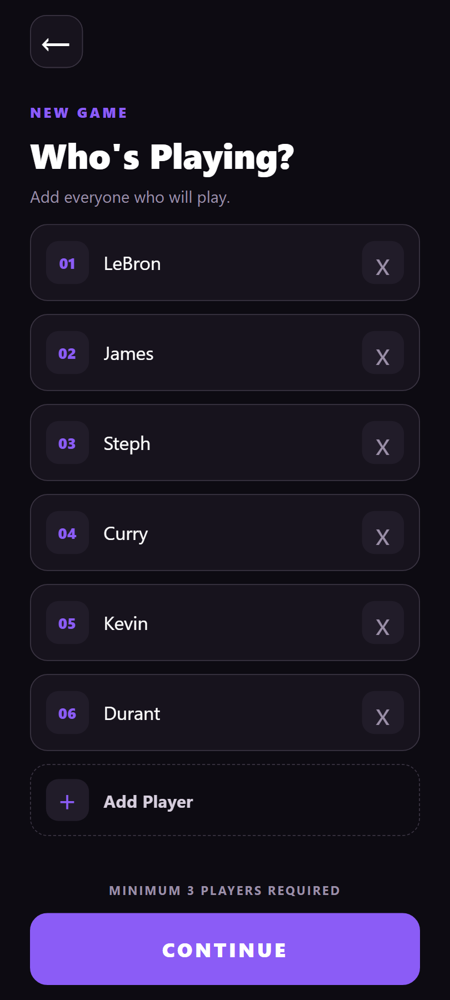
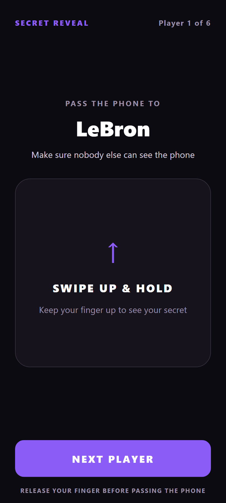
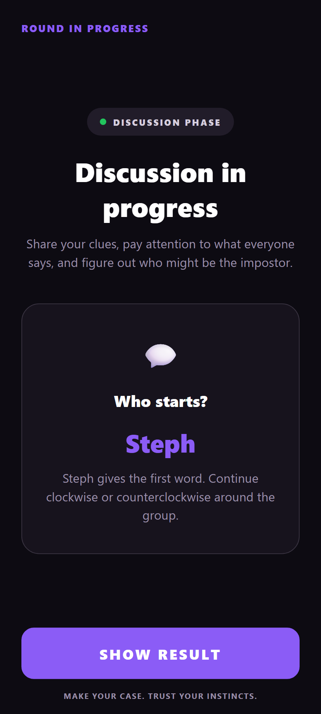

# Impostor

**Impostor** is an offline multiplayer party game built with React Native and Expo. Players pass a single phone around to privately receive their role and secret word, then give clues and discuss who they think the impostor is.

No internet connection or backend is required — the entire game runs locally on the device.

---

## Features

- **Pass-the-phone gameplay** — Players privately reveal their roles and secret words on a shared device.
- **Multiple impostors** — Supports rounds with more than one impostor.
- **Classic & Chaos modes**
  - **Classic:** Players choose the number of impostors.
  - **Chaos:** The number of impostors is randomly selected, including the possibility of no impostor.
- **Discussion phase** — A random player is selected to give the first clue before players continue around the group.
- **Optional impostor hints** — Impostors can receive a hint related to the secret word.
- **Multiple categories** — Choose from categories such as Places, Food, People, Animals, Objects, Technology, Fantasy, Movies & TV, Sports, and Video Games.
- **Difficulty selection** — Choose between Easy, Medium, and Hard words.
- **3–12 players** — Designed for small and medium-sized groups.
- **Offline gameplay** — No accounts, server, or internet connection required.
- **Mobile-first interface** — Designed specifically for a shared-phone party game.
- **Gesture-based reveal** — Players interact with the reveal screen to privately view their information.
- **Dark UI** — A dark interface designed for comfortable use during group play.

---

## Screenshots







---

## Tech Stack

### Frontend

- **React Native**
- **Expo**
- **TypeScript**
- **Expo Router**

### State & Interaction

- **Zustand** — Local game state management
- **React Native Gesture Handler** — Gesture interactions
- **React Native Reanimated** — Reveal animations and gesture-driven UI

### Architecture

- Component-based UI
- File-based routing
- Local/offline game logic
- Type-safe game state and configuration
- Reusable UI components

---

## How to Run

### Prerequisites

Make sure you have the following installed:

- Node.js
- npm
- Expo development environment
- Android Studio and/or an Android device for testing

### 1. Clone the repository

```bash
git clone https://github.com/ron12341/impostor-game.git
cd impostor-game
```

### 2. Install dependencies

```bash
npm install
```

### 3. Start the development server

```bash
npx expo start
```

You can then open the application using an Android emulator or a connected Android device.

### Android

```bash
npx expo start
```

Press `?` in the Expo CLI to show all commands.

---

## How the Game Works

### 1. Set Up the Game

Add between **3 and 12 players** and configure the round.

Players can choose:

- Game mode
- Number of impostors
- Word categories
- Word difficulty
- Impostor hint mode

### 2. Reveal Roles

The phone is passed from player to player.

Each player privately reveals their information:

**Normal player:**

> Receives the secret word.

**Impostor:**

> Does not receive the secret word and may receive a related hint depending on the selected settings.

Players should keep their information secret from everyone else.

### 3. Give Clues

After everyone has seen their information, the game enters the discussion phase.

A player is randomly selected to give the **first clue**.

That player gives one word related to the secret word. The other players then continue around the group, either clockwise or counterclockwise.

Players should give clues that are related enough to show that they know the word, but not so obvious that they reveal it to the impostor.

### 4. Discuss

Once everyone has given a clue, the group discusses the answers and tries to determine who the impostor is.

Pay attention to:

- Suspiciously vague clues
- Clues that don't seem related
- Players copying previous clues
- Players who appear to be guessing

### 5. Reveal the Result

When the group is ready, reveal the result to see who the impostor or impostors were.

In **Chaos Mode**, there may be no impostor at all.

---

## Project Structure

The project follows a feature-oriented structure with separate screens, reusable UI components, game state, data, and utility logic.

```text
src/
├── app/
│   ├── index.tsx
│   ├── how-to-play.tsx
│   └── game/
│       ├── setup.tsx
│       ├── reveal.tsx
│       ├── discussion.tsx
│       ├── results.tsx
│       └── settings.tsx
│
├── components/
│   └── ui/
│       ├── AppButton.tsx
│       ├── Screen.tsx
│       └── HoldToReveal.tsx
│
├── constants/
│   └── colors.ts
│
├── data/
│   ├── words
│   │   ├── food.json
│   │   ├── people.json
│   │   ├── places.json
│   │   ├── sports.json
│   │   ├── objects.json
│   │   ├── animals.json
│   │   ├── fantasy.json
│   │   ├── technology.json
│   │   ├── videoGames.json
│   │   └── moviesAndTV.json
│   │
│   └── words.ts
│
├── screens/
│   ├── HomeScreen.tsx
│   ├── RevealScreen.tsx
│   ├── ResultsScreen.tsx
│   ├── GameSetupScreen.tsx
│   ├── HowToPlayScreen.tsx
│   ├── DiscussionScreen.tsx
│   └── GameSettingsScreen.tsx
│
├── store/
│   └── gameStore.ts
│
├── types/
│   └── game.ts
│
└── utils/
    ├── game.ts
    └── random.ts
```
